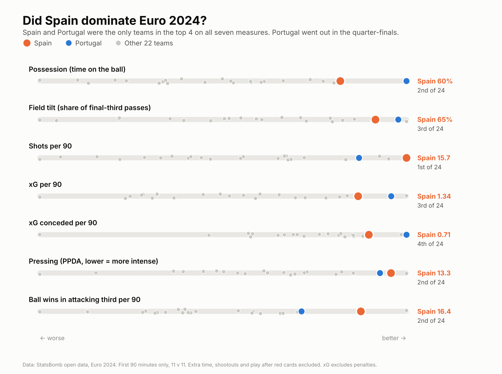
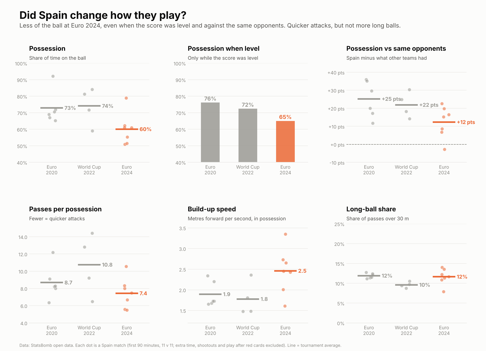
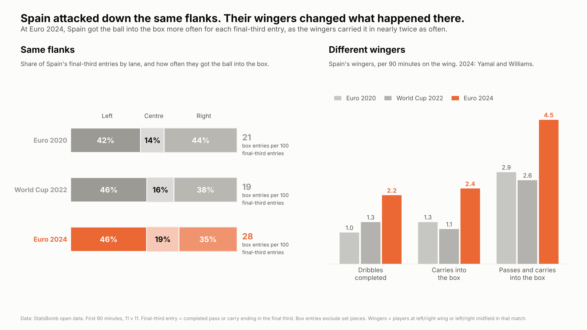
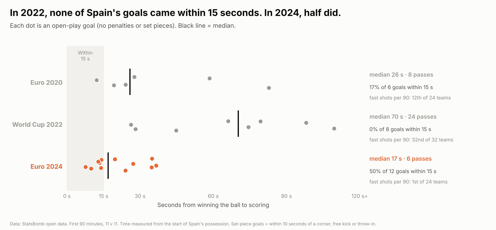

# Did Spain change how they play to win Euro 2024?

Spain won all seven matches at Euro 2024. This project uses StatsBomb open event data to ask how dominant they really were, and whether they won by changing their style. It compares Spain across three consecutive tournaments, all complete in the open data:

| Tournament | Spain's result | Matches |
|---|---|---|
| Euro 2020 | Semi-final | 6 |
| World Cup 2022 | Round of 16 | 4 |
| Euro 2024 | Champions, 7 wins from 7 | 7 |

It runs in four parts:

1. How dominant were Spain at Euro 2024, compared with all 24 teams?
2. Did their style change, and does the change survive checks for game state and opponent strength?
3. How did they attack: which flanks, and what did their wingers do?
4. How quickly did they score after winning the ball?

## Key findings

**1. Dominant, but not alone.** Spain were in the top 4 of 24 teams on all seven dominance measures: 1st for shots, 2nd for possession, pressing and ball wins in the attacking third, 3rd for territory and xG, 4th for xG conceded. Only Portugal, knocked out in the quarter-finals, matched that. Spain were also clinical: in the first 90 minutes they scored 13 goals from shots from 9.9 xG (plus one own goal), and conceded 3 goals from shots against 5.3 xG (plus one own goal).



**2. Less of the ball, quicker attacks, but not more long balls.** Spain's possession fell from 73% (Euro 2020) and 74% (World Cup 2022) to 60%. The drop holds when the score was level (76% and 72%, down to 65%) and when compared with what other teams managed against the same opponents (+25 and +22 points, down to +12). Spain used fewer passes per possession (8.7 and 10.8, down to 7.4) and moved the ball forward faster, but their long-ball share did not change (12%, 10%, 12%). Even so, at Euro 2024 their build-up speed ranked only 19th of 24: quicker than their own past, not a counter-attacking side.



**3. Same flanks, different wingers.** Spain's final-third entries split almost identically by lane in all three tournaments. What changed was the wingers: per 90 minutes on the wing, Spain's wingers (mostly Yamal and Williams, who played 79% of the winger minutes) completed 2.2 dribbles (1.0 and 1.3 before) and carried the ball into the box 2.4 times (1.3 and 1.1 before). Spain made 28 box entries per 100 final-third entries, up from 21 and 19.



**4. Quick when it mattered.** At the 2022 World Cup none of Spain's 8 open-play goals came within 15 seconds of winning the ball (median 70 seconds, 24 passes), and they were the slowest of 32 teams for fast shots. At Euro 2024, 6 of 12 open-play goals came within 15 seconds (median 17 seconds, 6 passes), and they took the most fast shots per 90 of any team. Only 30% of their shots were fast, close to the tournament median, so they led on fast shots through volume rather than by becoming a counter-attacking side. Their pressing created shots (3rd for shots after winning the ball in the attacking third) but no goals in any of the three tournaments.



## Cleaning rules (applied in every part)

- **First 90 minutes only.** Extra time and penalty shootouts are excluded. Shootout kicks are recorded as shots and would otherwise inflate shot counts.
- **11 against 11 only.** If a red card is shown in the first 90 minutes, the match is cut at that moment for both teams (for example, Switzerland against Spain at Euro 2020 from the 76th minute).
- **Per 90** figures use the minutes kept after these rules.

## Definitions

- **Possession** is measured two ways: share of passes, and share of time on the ball from StatsBomb's possession sequences. They agree closely (correlation 0.83).
- **Field tilt:** share of the match's open-play passes in the final third.
- **PPDA:** opponent open-play passes in their own defensive 60% of the pitch, divided by the team's tackles, interceptions and fouls in that zone. Lower means more intense pressing.
- **Ball wins:** ball recoveries (not failed), interceptions that won the ball, and tackles that won the ball.
- **Game state:** each possession is labelled level, leading or trailing by the score when it started.
- **Opponent-adjusted:** a team's value in a match minus the average value other teams achieved against the same opponent at the same tournament.
- **Lanes:** left, centre and right thirds of the pitch width, from the attacking team's view.
- **Final-third entry:** a completed pass or carry that starts before the final third and ends in it.
- **Box entry:** a completed open-play pass or a carry that starts outside the penalty box and ends inside it.
- **Wingers:** players listed at left or right wing, or left or right midfield, in that match.
- **Open-play shot or goal:** excludes penalties and shots within 10 seconds of a corner, free kick or throw-in.
- **Fast shot or goal:** within 15 seconds of the start of the team's possession.
- **High regain:** a possession whose first event by the team is in the attacking third and did not start from a restart.
- **xG** is StatsBomb's expected goals value and excludes penalties throughout.

## Limitations

- **Small samples:** 4 to 7 matches per tournament, and 8 to 12 open-play goals each. The charts show every match or goal so the spread is visible.
- **The opponent adjustment** relies on only 2 to 6 reference matches per opponent.
- **Tournament football is not a controlled experiment.** Squads, coaches and opponents all changed between 2021 and 2024, so this shows how Spain's play changed, not why.
- **"No goals from high regains"** holds for the definition above. A different definition of a high regain could count some goals differently.

## Checks

`checks.py` reproduces the data-integrity and robustness tests:

- every tournament loads fully, and possession shares sum to 100% in every match
- first-90 goals equal the official score in all 138 matches without extra time or a red-card cut (tests goals, own goals and the shootout exclusion)
- left and right lanes are oriented correctly: 82% of Yamal's touches fall in the right lane and 82% of Williams's in the left
- the fast-goal finding holds when every possession that started from a set piece is excluded (Euro 2024: 3 of 6 goals within 15 seconds; World Cup 2022: 0 of 5)

## How to run

Requires Python 3.10 or later.

```bash
pip install -r requirements.txt

python part1_spain_vs_field.py           # downloads all 166 matches once (several minutes)
python part1b_opponent_adjusted.py
python part1c_chart.py
python part2_spain_three_tournaments.py
python part2b_chart.py
python part3_how_spain_attacked.py
python part3b_chart.py
python part4_speed_transitions.py
python part4b_chart.py
python checks.py
```

Run the scripts from the repository folder, in this order. `common.py` holds the data loading and cleaning rules and `features.py` the team measures; both are used by the part scripts. Event files are cached in `data/`, which is not committed. Tables are saved to `results/` and charts to `figures/`.

Charts use the Inter font if it is installed and fall back to the default font otherwise.

## Data

Data: [StatsBomb open data](https://github.com/statsbomb/open-data) (UEFA Euro 2020, FIFA World Cup 2022, UEFA Euro 2024). Please credit StatsBomb as the data source in any work that uses it.

## Related projects

- [How did the 2015/16 champions win their leagues?](https://github.com/rafizrayhan/statsbomb-champions-2015-16)
- [Same Golden Boot, different routes? The 2015/16 top scorers](https://github.com/rafizrayhan/statsbomb-top-scorers-2015-16)
- [Who created the most in 2015/16?](https://github.com/rafizrayhan/statsbomb-creators-2015-16)
